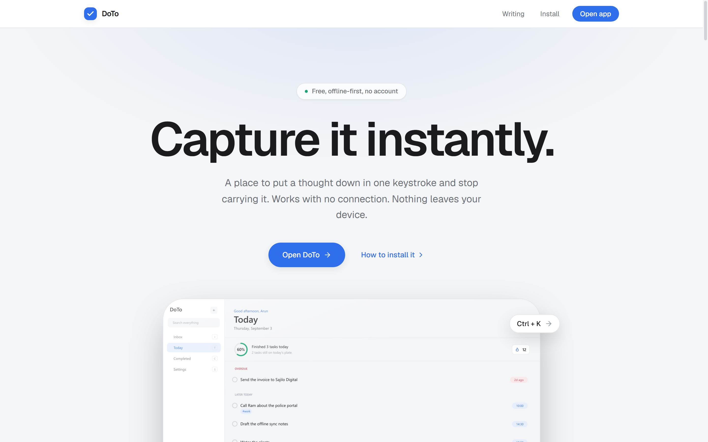
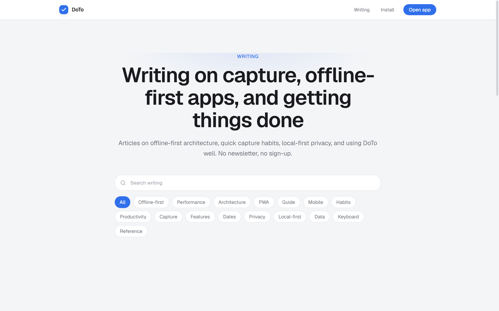
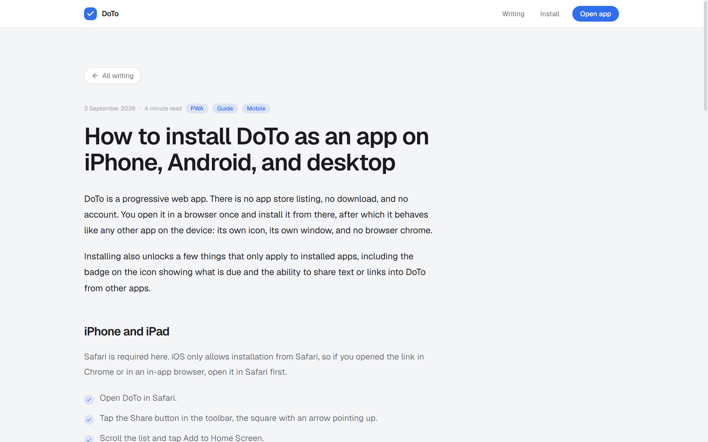
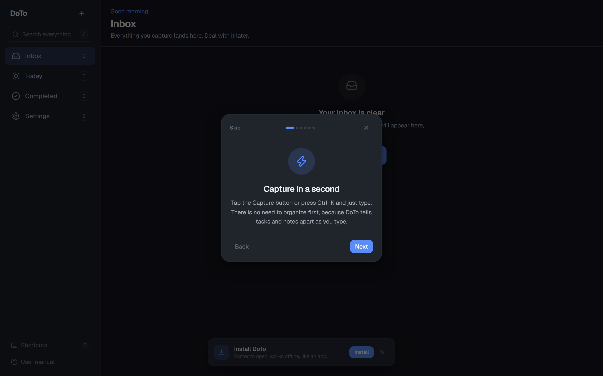
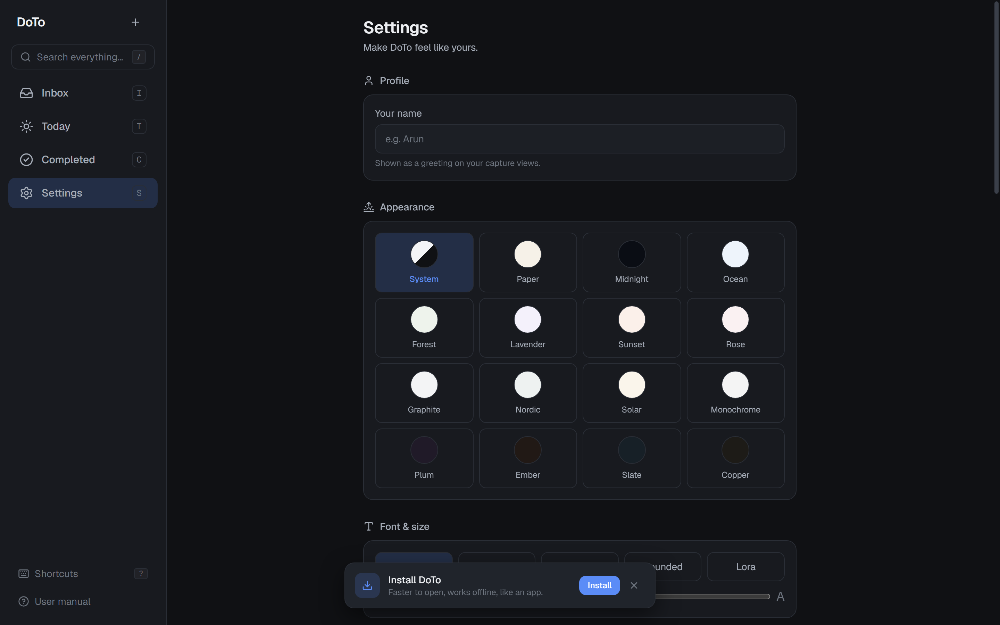
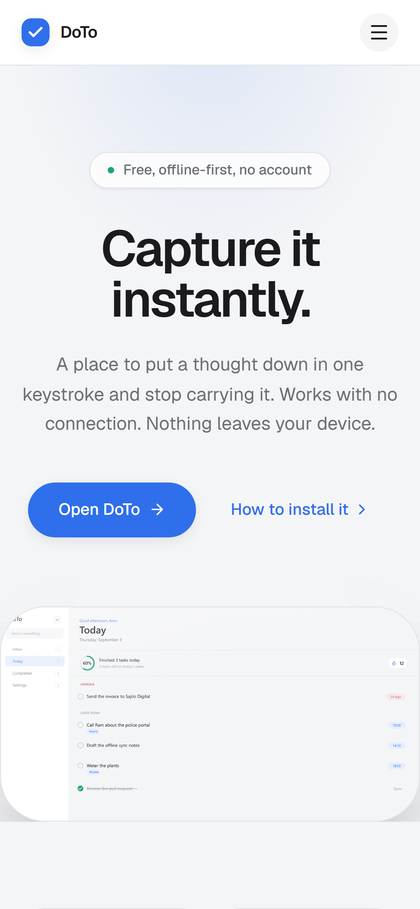
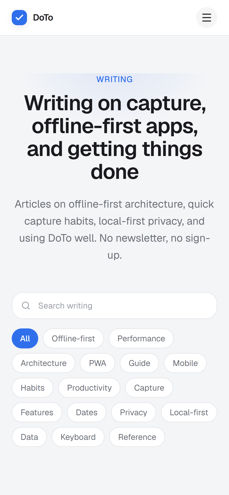
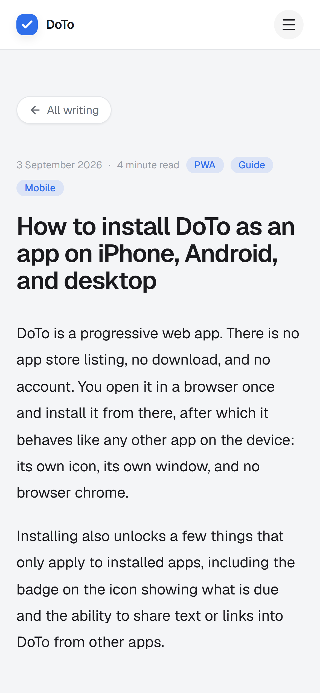
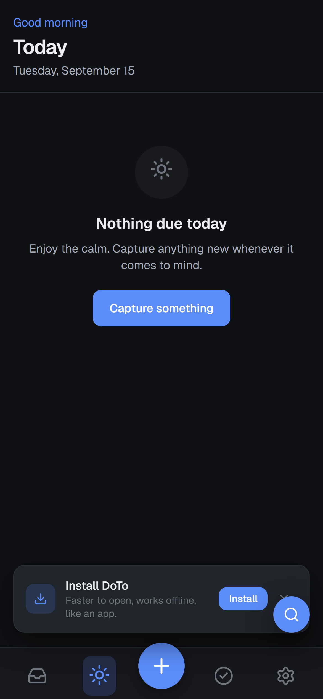
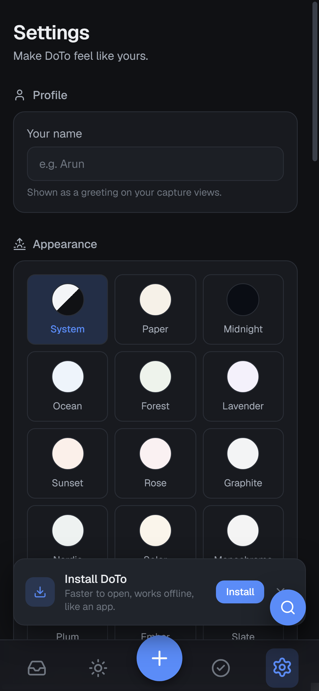

# DoTo

> **Capture it instantly. Organize it later. Finish it beautifully.**

DoTo is a premium offline-first PWA for quick capture and tasks. It is designed to be the fastest, most satisfying place to put down something you need to remember, whether that is a task, note, idea, checklist, reminder, link, or a fleeting thought.

This is not another bloated productivity suite. It is a frictionless personal capture system that happens to have tasks. The competitive advantage is exceptional UX: speed, responsiveness, thoughtful motion, and an extremely low-friction capture experience.

## Screenshots

### Desktop



<div align="center">


</div>

<div align="center">


</div>

### Mobile

<div align="center">



</div>

<div align="center">


</div>

## Core Philosophy

**Think -> Capture -> Forget about it -> Return when needed -> Complete -> Feel satisfied**

The user should never be forced to organize something before capturing it. Capture first. Organization later.

## Features (V1)

**Capture**
- Instant-focus Quick Capture (Ctrl+K)
- Natural language parsing: type `Call Ram tomorrow at 10` and DoTo understands the title, date, and time
- Capture is never mandatory to interpret: type `Buy milk` and it simply saves
- Tags with autocomplete: type `#` and DoTo suggests tags you already use
- Smart paste: a multi-line paste can land as separate items or one checklist, and an image pastes straight in as an attachment
- Voice capture where the browser supports speech recognition
- Command mode: type `>` in the capture field to jump to a view or open the manual
- Keyboard capture (`Ctrl+K`, `N`, `/`, `T`, `I`, `C`)
- PWA app shortcuts and share target

**Items**
- Unified items that evolve: a thought can become a task, then gain a checklist, due date, and reminder
- Tasks, notes, and checklists
- Due dates and times
- Recurring tasks
- Reminders that notify you, as a system notification where permitted and always inside the app
- Tags
- Attachments and links
- Drag to reorder the unsorted Inbox

**Views**
- Inbox: everything captured lands here, friction-free
- Today: a focused view of today's tasks and reminders, with a progress ring, daily streak, and one-tap carry-over for anything overdue
- Completed: a quiet record of everything finished
- Search: instant across tasks, notes, tags, and links

**Experience**
- Satisfying completion interactions with coordinated motion
- Subtle, configurable sound and haptic feedback
- 16 themes, including one that follows your system appearance
- Full keyboard, touch, and accessibility support
- Offline-first by design

## Keyboard

| Key | Action |
| --- | --- |
| `Ctrl/Cmd + K` | Quick Capture |
| `/` or `Ctrl/Cmd + F` | Search |
| `I` / `T` / `C` / `S` | Inbox, Today, Completed, Settings |
| `J` / `K` or arrows | Move between items |
| `Space` | Complete the focused item |
| `Enter` | Open the focused item |
| `Ctrl/Cmd + Z` | Undo the last completion or deletion |
| `?` | Keyboard shortcuts |
| `Esc` | Close the topmost layer |

Inside Quick Capture, `#` opens tag suggestions and `>` switches to command mode.

## Tech Stack

- **Next.js 16** (App Router, static export)
- **TypeScript**
- **Tailwind CSS v4**
- **Zustand** for client state
- **Dexie.js** (IndexedDB) for offline persistence
- **Framer Motion** for animation
- **Lucide** for icons

## Architecture

DoTo is architecturally **offline-first and local-first**:

- All data is stored locally in the browser using IndexedDB (through Dexie). `localStorage` is never used as the primary database.
- The application shell is cached by a service worker (`public/sw.js`) so the app launches reliably without an internet connection.
- The app is built as a **static export** (`output: "export"`), meaning it can be hosted on any static web server or CDN.
- V1 requires **no account and no network** for core functionality. Online sync is intentionally not included and the data layer is designed to support it in a future version without a rewrite.

### Folder Structure

```
src/
  app/
    (app)/                The app itself: inbox, today, completed, settings
    blog/                 Article index and one page per post
    page.tsx              Landing page, statically rendered
    layout.tsx            Root html, fonts, and shared metadata
    manifest.ts           Web app manifest
    robots.ts             robots.txt
    sitemap.ts            sitemap.xml
    opengraph-image.tsx   Social card, generated at build time
  components/
    capture/              Quick capture flow
    items/                Task, note, list, and attachment components
    layout/               App shell
    marketing/            Shared public surfaces: header, footer, brand icons,
                          scroll-to-top
    navigation/           Sidebar and bottom navigation
    search/               Search overlay
    settings/             Data, notification, and reset controls
    ui/                   Base design-system components
    views/                Page-level views
  content/
    posts.ts              Articles, as typed data rather than MDX
  lib/
    stores/               Zustand stores (items, settings, app, toast, undo)
    hooks/                useSound, useHaptics, reminders, shortcuts, etc.
    utils/                NLP parser, dates, recurrence, storage, cn
    site.ts               Origin, product copy, and author details
  providers/              Theme, font, app bootstrap
  types/                  TypeScript data model
public/
  sw.js                   Service worker (offline shell)
  icons/                  App icons, generated by scripts/generate-icons.mjs
  screenshots/            Product shots, generated by scripts/
docs/
  screenshots/            Real page captures for this README, generated by
                          scripts/screenshot.mjs (Chrome DevTools Protocol)
scripts/                  Asset generation and verification, run manually and
                          committed
```

### Design System

All visual values live as CSS custom properties in `src/app/globals.css`. Components consume tokens such as `--bg`, `--surface`, `--accent`, `--radius-md`, `--duration-base`, and so on through the Tailwind `@theme inline` mapping. Style intent:

- No hardcoded colors or fonts in components.
- 16 themes swap these tokens at runtime, one attribute change away.
- A custom theme creator can be added later without touching the UI.

## Getting Started

### Prerequisites

- Node.js 20+ and npm

### Install

```bash
npm install
```

### Development

```bash
npm run dev
```

Open [http://localhost:3000](http://localhost:3000).

### Production build

```bash
npm run build
```

The static export is written to `out/`. Serve it from any static host.

### Lint

```bash
npm run lint
```

## Deployment

The static export in `out/` is served from
[sajilotodo.vercel.app](https://sajilotodo.vercel.app) with the Vercel static
host and will run on any static host or CDN.

The production origin is set in `src/lib/site.ts` and is the single source for
canonical URLs, the sitemap, and social card images. Override it for a preview
deployment or a different domain:

```bash
NEXT_PUBLIC_SITE_URL=https://preview.example npm run build
```

### Routes

The app and the marketing site share one origin but nothing else. App routes
live in the `(app)` route group, which carries the client shell; everything
else is statically rendered with no client JavaScript at all.

| Route | What it is | Indexed |
| --- | --- | --- |
| `/` | Landing page | Yes |
| `/blog` and `/blog/<slug>` | Articles | Yes |
| `/inbox`, `/today`, `/completed`, `/settings` | The app | No |

App routes render only the person's own local data, so there is nothing to
index. They are marked `noindex`, disallowed in `robots.txt`, and left out of
the sitemap. The installed PWA starts at `/inbox/`, so it never sees the
landing page.

### Writing

Articles are plain TypeScript in `src/content/posts.ts` rather than MDX, which
keeps the build free of extra tooling. Each post carries its own FAQ, which is
rendered on the page and emitted as `FAQPage` structured data, so the answers a
search or answer engine quotes are the same words a reader sees. Adding a post
means adding one object; the index, sitemap, and structured data follow from it.

### Regenerating assets

Icons and screenshots are committed, so a normal build needs no image tooling.
Regenerate them after a visual change:

```bash
node scripts/generate-icons.mjs
node scripts/generate-screenshots.mjs
```

Icons are built in three shapes because the platforms differ: rounded with
transparent corners for browser tabs, full bleed with the mark inside the safe
zone for launcher masking, and full bleed and opaque for iOS, which composites
transparency onto black. Screenshots are drawn from the app's own light theme
tokens rather than captured, so they stay sharp at any size. They illustrate the
real layout rather than photographing it.

The captures in `docs/screenshots/` for this README use headless Chrome against
the production build, served locally:

```bash
npm run build
node scripts/serve-out.mjs   # serves out/ on http://localhost:4173
node scripts/screenshot.mjs  # writes to docs/screenshots/
```

Both `serve-out.mjs` and `screenshot.mjs` read the Chrome DevTools Protocol;
the screenshot script emulates `prefers-reduced-motion` so every entrance
animation's final state is captured.

## Reminders


Reminders are delivered while DoTo is open. V1 has no server and no push
subscription, so there is nothing to wake the app in the background. Where
notification permission is granted a reminder raises a system notification, and
in every case it also appears as an in-app toast with a sound and a haptic, so
the behaviour degrades predictably when notifications are blocked or the
platform does not support them.

Background delivery needs Web Push, which requires a server, and is intentionally
out of scope for V1 alongside sync.

### Test

```bash
npm test
```

Vitest covers the pure logic where the subtle bugs live: the natural-language
parser, recurrence rollover, and the date and streak maths. Component behaviour
is deliberately not covered, since a DOM harness would cost more than it returns
on a UI this visual. Tests sit beside the code they cover as `*.test.ts` and run
in Node with no browser environment.

```bash
npm run test:watch
```

## Offline Usage

To test offline behavior, build and serve the app, then go offline in your DevTools Network panel. The application shell loads from the service worker cache and new items persist to IndexedDB immediately.

## Accessibility

Accessibility is a first-class feature. DoTo supports keyboard navigation with visible focus states, screen readers via semantic HTML and ARIA where necessary, sufficient color contrast, generous touch targets, and full `prefers-reduced-motion` support. The app remains fully usable without touch, sound, animation, or color.

## Privacy

DoTo is privacy-friendly by default. Basic usage requires no account, and all user data stays on the device. No advertising or tracking is built into the application.

## License

DoTo is source available under the DoTo Non-Commercial Licence. It is free to
use, study, modify, and share for any non-commercial purpose. Selling it, or
offering it as a paid or ad-supported service, needs written permission from the
author. See [LICENSE](LICENSE).
